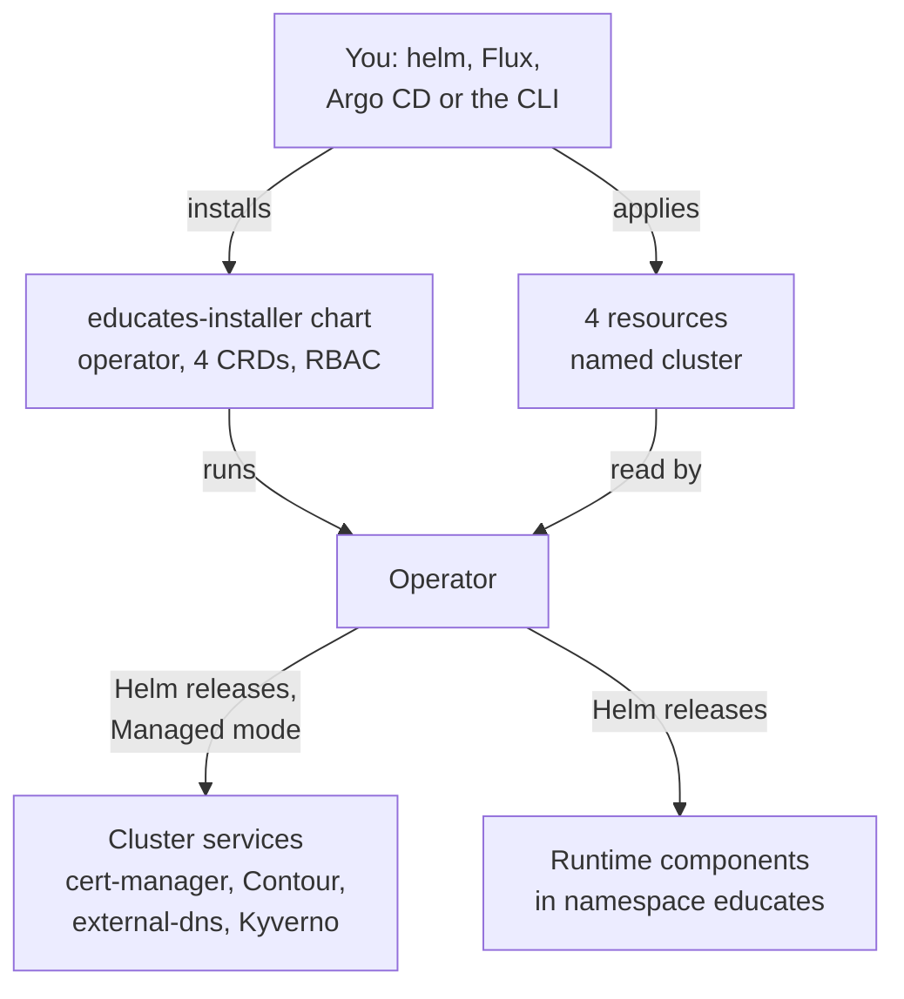

In March 2025, [How the installer works (Part 1)](/blog/how-installer-works-part-1) described the installer that came with Educates 3: part of the Go CLI, running Carvel's tools as libraries, and expanding your configuration into opinionated values for each cluster infrastructure provider. It promised a part 2 on those providers. That part never came, and the installer it would have described is gone. Why?

The primary reason is that we were relying on a set of tools that have been (or at least feel) abandoned. These tools are the [Carvel toolchain](https://carvel.dev/). We have seen very low maintainance on those projects and adoption was rapidly decreasing since Broadcom acquired VMware. We needed a change. Our imperative and declarative way of installing clusters was way too different, and in they were relying on different (although adjacent) tools from the carvel toolchain, kapp and kapp-controller. We were also hearing voices asking for a way to install educates using `Helm`, so we have heard you and we have decided to take a big step.

Educates 4 is installed with a Helm chart. One small chart, `educates-installer`, holds an operator, four custom resource definitions and the operator's RBAC. You install it, apply four custom resources that describe the installation you want, and the operator installs the rest. `helm install`, Flux, Argo CD and the `educates` CLI all install that same chart, so there is one install path with several drivers rather than one path per tool.

This series picks up where the 2025 one stopped. Educates 4.0 isn't final yet: everything here uses 4.0.0-alpha.14, the latest prerelease, and the chart has shipped since 4.0.0-alpha.6. 

**This is still a work in progress, so any early feecback will be more than welcome.**

## What the Chart Installs

The chart holds three kinds of objects and nothing else:

- **The operator:** a `Deployment` named `educates-installer`, one replica of a static Go binary on a distroless image, running as non-root with every capability dropped.
- **Four custom resource definitions,** all cluster scoped: `EducatesClusterConfig` in `config.educates.dev`, and `SecretsManager`, `LookupService` and `SessionManager` in `platform.educates.dev`.
- **RBAC:** the operator's `ServiceAccount`, two `ClusterRole`s bound to it, and two unbound roles for your users.

Rendering the published chart lists the objects in its templates. The four CRDs sit in `crds/`, which `helm template` leaves out unless you add `--include-crds`:

```
$ helm template educates-installer oci://ghcr.io/educates/charts/educates-installer \
    --version 4.0.0-alpha.14 --namespace educates-installer \
    | yq -N 'select(.kind) | .kind + "/" + .metadata.name'
Pulled: ghcr.io/educates/charts/educates-installer:4.0.0-alpha.14
Digest: sha256:f835f2b7f3c5955c1887c32e03afdb34a7cb0916d30f0baf6b57dcbfa36446f4
ServiceAccount/educates-installer
ClusterRole/educates:installer:charts
ClusterRole/educates:installer:manager
ClusterRole/educates:rbac:admin:platform
ClusterRole/educates:rbac:view:platform
ClusterRoleBinding/educates:installer:charts
ClusterRoleBinding/educates:installer:manager
Deployment/educates-installer
```

Installing the chart changes nothing you can see. The operator starts and waits for four custom resources, one of each kind, each named `cluster`. `EducatesClusterConfig` describes the cluster services and the ingress Educates relies on, and the other three each describe one Educates component. [Part 2](/blog/educates-4-operator-and-crds) covers them in depth. And don't worry, that blog is alerady written this time :-D .

Once they exist, the operator installs everything else as Helm releases, from charts it carries inside its own image. 

Since Educates requires some additional services to function properly, there's two different ways to provide these. 
- `Managed mode`, that includes the cluster services, each in a namespace of its own. 
- `Inline mode`, you bring your own cluster services and the operator only checks them. 

In both modes, the runtime components of Educates go into the `educates` namespace.



The chart has no Helm hooks, no `lookup` calls and no `.Capabilities` checks, so what `helm template` renders is what a GitOps controller applies.

## Where the Chart Lives

Every release pushes the chart to `oci://ghcr.io/educates/charts/educates-installer`, with the release tag as both its version and its app version.

Look at it before you install it:

```bash
helm show chart oci://ghcr.io/educates/charts/educates-installer --version 4.0.0-alpha.14
helm show values oci://ghcr.io/educates/charts/educates-installer --version 4.0.0-alpha.14
```

## Installing It by Hand

The example below installs Educates in Managed mode on a cluster that can provision a `LoadBalancer` Service, with workshops under `workshops.example.com` and certificates issued from a CA of your own. The [samples](https://github.com/educates/educates-training-platform/tree/develop/installer/samples) in the repository cover the other scenarios, such as ACME on GKE and EKS, or Inline mode on a cluster that already has its services.

### Install the Operator

```bash
helm install educates-installer oci://ghcr.io/educates/charts/educates-installer \
  --version 4.0.0-alpha.14 \
  --namespace educates-installer --create-namespace

kubectl -n educates-installer rollout status deployment/educates-installer
```

Keep `educates-installer` as both the release name and the namespace. The CLI uses the same names, so its commands, `educates admin platform delete` among them, find a release you installed with Helm.

Wait for the rollout before applying anything, as the CLI does: on an upgrade, that makes sure the new operator, not the old one, reconciles what you apply next.

### Create the Secrets the Cluster Config Names

A Secret that `EducatesClusterConfig` names without a namespace has to exist in the operator namespace before the resource can become ready. This example issues the wildcard certificate from your own CA, so it needs that CA's key pair. A throwaway CA is enough for a test cluster:

```bash
openssl req -x509 -new -nodes -newkey rsa:2048 -sha256 -days 365 \
  -keyout ca.key -out ca.crt -subj "/CN=Educates Example CA" \
  -addext "basicConstraints=critical,CA:TRUE" \
  -addext "keyUsage=critical,keyCertSign,cRLSign"

kubectl -n educates-installer create secret tls educates-custom-ca \
  --cert=ca.crt --key=ca.key
```

The operator checks that the certificate really is a CA. Browsers won't trust this one until you import `ca.crt`. In a `Managed install` with ACME on GKE or EKS there is no Secret to create, only Workload Identity or IRSA.

### Apply the Four Resources

One file per resource, here shown together. Don't worry if you don't understand them in detail, there's still a lot of reading you will need to do:

```yaml
# educates-cluster-config.yaml
apiVersion: config.educates.dev/v1alpha1
kind: EducatesClusterConfig
metadata:
  name: cluster
spec:
  mode: Managed
  ingress:
    domain: workshops.example.com
    ingressClassName: contour
    controller:
      provider: BundledContour
    certificates:
      provider: BundledCertManager
      bundledCertManager:
        issuerType: CustomCA
        customCA:
          caKeyPairSecretRef:
            name: educates-custom-ca
  policyEnforcement:
    clusterPolicy:
      engine: Kyverno
    workshopPolicy:
      engine: Kyverno
    kyverno:
      provider: Bundled
---
# educates-secrets-manager.yaml
apiVersion: platform.educates.dev/v1alpha1
kind: SecretsManager
metadata:
  name: cluster
spec:
  logLevel: info
---
# educates-lookup-service.yaml (optional)
apiVersion: platform.educates.dev/v1alpha1
kind: LookupService
metadata:
  name: cluster
spec:
  ingress:
    prefix: lookup
  logLevel: info
---
# educates-session-manager.yaml
apiVersion: platform.educates.dev/v1alpha1
kind: SessionManager
metadata:
  name: cluster
spec:
  logLevel: info
```

Apply them in dependency order:

```bash
kubectl apply -f educates-cluster-config.yaml
kubectl wait --for=condition=Ready educatesclusterconfig/cluster --timeout=600s

kubectl apply -f educates-secrets-manager.yaml
kubectl apply -f educates-lookup-service.yaml
kubectl apply -f educates-session-manager.yaml

kubectl wait --for=condition=Ready secretsmanager/cluster sessionmanager/cluster --timeout=600s
```

The order is a convenience, not a requirement. Each component gates itself on the status of what it depends on, so applying all four at once also converges. Waiting on each step only tells you sooner where a problem is.

With no `spec.dns`, nothing manages DNS records for you. Once the Envoy `LoadBalancer` Service in the `contour` namespace has an external address, point a wildcard record for `*.workshops.example.com` at it:

```bash
kubectl -n contour get services
```

## Checking What It Installed

Health is summed up on the four resources:

```
$ kubectl get educatesclusterconfig,secretsmanager,lookupservice,sessionmanager
NAME                                                MODE      PHASE   AGE
educatesclusterconfig.config.educates.dev/cluster   Managed   Ready   2d21h

NAME                                           PHASE   AGE
secretsmanager.platform.educates.dev/cluster   Ready   2d21h

NAME                                          PHASE   AGE
lookupservice.platform.educates.dev/cluster   Ready   2d21h

NAME                                           PHASE   AGE
sessionmanager.platform.educates.dev/cluster   Ready   2d21h
```

Every cluster service and every component is a Helm release of its own, so `helm list -A` shows the whole installation. For this example, that is nine releases:

- `educates-installer` in `educates-installer`: the chart you installed.
- `cert-manager`, `contour` and `kyverno`, each in the namespace of the same name. `external-dns` joins them when `spec.dns` asks for it.
- `secrets-manager`, `lookup-service`, `session-manager`, `node-ca-injector` and `remote-access` in `educates`.

When something doesn't become ready, the conditions on the resource say why, and the values of each release show what the operator computed for it:

```bash
kubectl describe educatesclusterconfig cluster
helm -n contour get values contour
helm -n educates get values session-manager
```

If you checked a 3.x install with the [2025 verification post](/blog/verify-educates-cloud-install), some things have moved. Contour runs in `contour`, not `projectcontour`, and the wildcard `Certificate`, `educates-wildcard`, and its Secret, `educates-wildcard-tls`, live in the operator namespace, `educates-installer`.

## The Same Chart from the CLI

`educates admin platform deploy` is that walkthrough, automated. The CLI embeds a copy of the chart that CI keeps identical to the published one, and a deploy:

1. Server-side applies the four CRDs from that chart and waits for them to be established, because Helm installs a chart's `crds/` only on a first install.
2. Runs `helm upgrade --install` of the chart, as release `educates-installer` in the namespace of the same name.
3. Waits for the operator to roll out.
4. Applies each resource and waits for a `Ready` condition whose `observedGeneration` has caught up with the resource.

The CLI has no `--version` flag. It installs the chart it embeds, so the CLI's version is the Educates version you get, and a different version takes that version's CLI. [`educatesenv`](/blog/managing-multiple-versions-of-educates-cli) keeps several at hand.

`educates admin platform render` prints what `deploy` would apply, chart values and the four resources, without touching a cluster. That makes it the handoff from the CLI to Git. We will talk more about that in the [third post in the series](/blog/educates-4-cli-config-kinds)

## Driving It from Git

The chart and the four resources are the whole GitOps surface. Model them as two units that your GitOps tool applies in order: the chart first, then the resources, which can't be applied until their CRDs exist. Among the four resources, order doesn't matter.

You can get more details in the [Educates docs](https://docs.educates.dev/en/latest/installation-guides/helm-based-installation.html#gitops)

## Upgrading and Removing It

### Upgrading

An upgrade is a `helm upgrade` of the chart to the new version. 

**But remember we recommend creating new clusters and move traffic to them using the Lookup Service, instead of in place upgrades**

### Removing

Delete the resources before you uninstall the chart, and the `EducatesClusterConfig` last:

```bash
kubectl delete sessionmanager/cluster lookupservice/cluster secretsmanager/cluster
kubectl delete educatesclusterconfig/cluster
helm uninstall educates-installer --namespace educates-installer
```

Beware that some things stay after `helm uninstall`, as it would not be safe to delete them or because they were manually created.

## Least Privilege for the Operator

The Educates 3 GitOps path ran its installer as `cluster-admin`. The Educates 4 operator doesn't, by default. The chart binds its service account to two generated `ClusterRole`s, and neither holds a wildcard:

- **`educates:installer:manager`** comes from the reconcilers' kubebuilder RBAC markers: the operator's own API calls.
- **`educates:installer:charts`** comes from [`hack/generate-installer-rbac.sh`](https://github.com/educates/educates-training-platform/blob/develop/hack/generate-installer-rbac.sh): what the operator applies on behalf of the charts it installs.

One rule needs explaining. On `roles` and `clusterroles`, the charts role adds `bind` and `escalate` to the usual verbs. Kubernetes stops anyone from creating a role that grants more than they hold, and the charts create roles of their own that grant more than the operator holds. Those two verbs let a holder grant permissions it doesn't have itself, so the operator's service account still deserves the care you give any cluster-wide controller.

If the role misses a permission on your cluster, `--set rbac.clusterAdmin=true` adds a third binding, `educates:installer:cluster-admin`, to `cluster-admin` when you install the operator chart. Use it as a fallback only, and report the gap so the generator can be corrected.

The other two roles in the chart, `educates:rbac:admin:platform` and `educates:rbac:view:platform`, are bound to nothing. Grant them to the people or automation that manage or only read the four resources. They also aggregate into the built-in `admin` and `view` roles.

## Installing Behind an Air Gap

Every release attaches `educates-images-<version>.txt`, one digest-pinned image reference per line: the Educates images, the images in the session manager's inventory, and the upstream images of the cluster services.

The [air-gapped installation guide](https://docs.educates.dev/en/latest/installation-guides/airgapped-installation.html) covers the two-step copy across a real gap, and which registries accept repository paths that deep.

## Design Rationale

We wanted to do things more align with what you would expect from a platform like this. Some of the decisions were based on:

- **One chart, many drivers.** The chart is the artifact you consume, imperatively or from Git. The CRDs and both operator roles are generated straight into it, so there is one source of truth, and the CLI embeds a copy that CI checks for drift.
- **An operator, not a smarter CLI.** Ordering, readiness, the issuer and wildcard certificate, and finalizer-driven removal live in the operator, because a GitOps tool that applies manifests can't provide them. The CLI is left thin: install the chart, apply the resources, wait.
- **Vendored charts inside the operator image.** Each upstream chart is a tarball pinned by its hash in the repository, so a chart update is a deliberate, reviewable change rather than whatever an upstream registry serves at install time, and an air-gapped cluster needs no chart registry.
- **One release per component.** Install, upgrade and removal follow the resource that owns the release.
- **One version, taken from the tag.** Charts, images and CLI all carry the release tag, so there is no bump commit to forget and no matrix of chart and app versions.
- **Least privilege, generated and checked.** A hand-written role drifts from the charts it serves. A generated one fails the build instead.

## What Still Takes Some Care

Having said all of these, there's some obvious caveats and downsides that you need to consider:

- **No in-place upgrade from v3**, and no v3 and v4 side by side on one cluster. Export your `Workshop` and `TrainingPortal` resources, delete v3, install v4 and apply them again; sessions in flight are lost. The [migration guide](https://docs.educates.dev/en/latest/installation-guides/migrating-from-v3.html) has the steps.
- **Providers are fixed for the life of an install.** The API server rejects a change to how a cluster service is provided, such as the certificates provider or the ingress controller. Changing one means removing Educates and installing it again. This was a thoughtful decision, based on our recommendation of how we treat platform clusters.
- **Secrets come first.** Every Secret the cluster config names has to exist before it can become ready. The operator watches Secrets only in the namespaces it found at startup, so a reference edited to point at a new namespace needs an operator restart.

---

One chart, four resources and an operator that does the rest is the recommended way to install Educates 4, whichever tool drives it, because every driver installs the same artifacts: what you check by hand holds for the CLI and for Git. In the [next part of this series](/blog/educates-4-operator-and-crds), we'll open up that operator: the four singleton resources, Managed and Inline modes, the status contract each resource reports, and how it reconciles and tears down what it installs.
