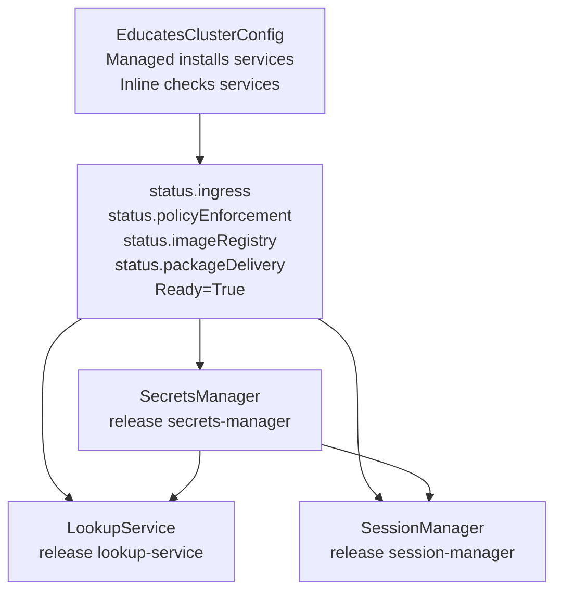

In [Part 1](/blog/installing-educates-4-with-helm), we installed the `educates-installer` Helm chart: an operator, four custom resource definitions and the RBAC they need, applied with `helm install`, although it could have been a GitOps tool. The operator that chart starts sits idle. Nothing happens until you apply four custom resources, and this part is about them: what each one owns, why status is the only interface between them, and how the operator orders, reports and tears down an install.

## What the 3.x Installer Never Recorded

The 3.x installer, which the [first post of the earlier series](/blog/how-installer-works-part-1) describes, ran inside the CLI. It expanded the short config you wrote through ytt overlays, one library per infrastructure provider, into a large values tree with settings for every package and a pinned list of every image, and applied the result with kapp.

It worked, but it left gaps. There were two configurations, the file you wrote and the expanded values that actually drove the install, which you rarely saw. The declarative path needed `kapp-controller` in every cluster. And nothing in the cluster said what was installed or whether it was healthy: checking an install meant walking namespaces and Deployments, as the [verification post](/blog/verify-educates-cloud-install) does.

That series promised a second part that never came. This series takes its place, because the installer it would have described is gone: Educates 4 moves the provider knowledge out of ytt overlays into typed custom resources, reconciled by Go code that records on them what it did.

## Four Singletons Named `cluster`

The operator lives in [installer/operator](https://github.com/educates/educates-training-platform/tree/develop/installer/operator) in the repository. It is a controller-runtime operator in the Kubebuilder layout, and it reconciles four cluster-scoped kinds:

- **`EducatesClusterConfig`**, in `config.educates.dev/v1alpha1` with the short name `ecc`, owns the cluster services Educates depends on: ingress, certificates, DNS, policy enforcement and the image registry.
- **`SecretsManager`**, **`LookupService`** and **`SessionManager`**, in `platform.educates.dev/v1alpha1`, each install one runtime component as a Helm release in the `educates` namespace.

Each one must be named `cluster`. A CEL rule on every CRD rejects any other name, with a message such as "EducatesClusterConfig must be named 'cluster' (singleton per cluster)". There is one Educates per cluster, so there is one of each, and because every dependency is a singleton, no resource carries a reference to another. A component knows where to look.

Here they are on a local kind cluster running a development build from `develop`:

```text
$ kubectl get educatesclusterconfig,secretsmanager,lookupservice,sessionmanager
NAME                                                MODE      PHASE   AGE
educatesclusterconfig.config.educates.dev/cluster   Managed   Ready   2d21h

NAME                                           PHASE   AGE
secretsmanager.platform.educates.dev/cluster   Ready   2d21h

NAME                                          PHASE   AGE
lookupservice.platform.educates.dev/cluster   Ready   2d21h

NAME                                           PHASE   AGE
sessionmanager.platform.educates.dev/cluster   Ready   2d21h
```

Every kind reports a phase: `Pending`, `Installing`, `Ready`, `Degraded` or `Uninstalling`, plus `Validating` on the cluster config. The phase is what you scan, but the CRDs say plainly that "phases are advisory; conditions carry the authoritative state". The CRDs also document themselves, since they are generated from the Go types and their comments: `kubectl explain educatesclusterconfig.spec` lists every field, and the CEL rules the API server enforces.

The first design had a single resource for the whole platform. We split it into four so that each component can be deployed on its own (the Lookup Service is optional), and so that each Helm release has exactly one resource owning it, which lines its install, upgrade and uninstall up with an object you can see.

## Managed and Inline: Two Roads to One Status

`spec.mode` decides how the cluster services come to exist. In Managed mode the operator installs cert-manager, Contour, external-dns and Kyverno itself, from charts it carries in its image. This is the production shape on EKS: a Let's Encrypt wildcard certificate through a Route53 DNS01 challenge, IAM roles for service accounts supplying the credentials, and external-dns publishing the records:

```yaml
apiVersion: config.educates.dev/v1alpha1
kind: EducatesClusterConfig
metadata:
  name: cluster
spec:
  mode: Managed
  ingress:
    domain: academy-01.workshops.example.com
    ingressClassName: contour
    controller:
      provider: BundledContour
      bundledContour:
        envoyServiceType: LoadBalancer
    certificates:
      provider: BundledCertManager
      bundledCertManager:
        issuerType: ACME
        acme:
          email: ops@example.com
          solvers:
            dns01:
              provider: Route53
              route53:
                hostedZoneID: Z0123456789ABCDEF
                region: us-east-1
                iamRoleARN: arn:aws:iam::123456789012:role/educates-cert-manager
  dns:
    provider: BundledExternalDNS
    bundledExternalDNS:
      provider: Route53
      sources:
        - service
      route53:
        hostedZoneID: Z0123456789ABCDEF
        region: us-east-1
        iamRoleARN: arn:aws:iam::123456789012:role/educates-external-dns
  policyEnforcement:
    clusterPolicy:
      engine: Kyverno
    workshopPolicy:
      engine: Kyverno
    kyverno:
      provider: Bundled
```

The operator works through that spec in a fixed order, and waits for each service to roll out before it moves on to the next:

1. **Certificates.** The Helm release `cert-manager` in namespace `cert-manager`, then a ClusterIssuer `educates-wildcard-issuer` and a Certificate for the domain and its wildcard, written to the Secret `educates-wildcard-tls` in the operator namespace.
2. **Ingress.** The release `contour` in namespace `contour`, which creates the IngressClass named in `ingressClassName`.
3. **DNS.** The release `external-dns`, only with `BundledExternalDNS`, publishing the wildcard record for the ingress domain.
4. **Policy.** The release `kyverno`, only with the `Bundled` provider and a Kyverno engine.

Every block names a provider, and that is the design: the spec says which capability you want and who provides it, never values for an upstream chart. `certificates.provider` can also be `StaticCertificate`, which serves a certificate you already have, or `None`. `spec.policyEnforcement` is required, so running without workshop security means setting both engines to `None`: a choice you write down, not a default you miss.

Inline mode is for clusters whose ingress, certificates and policy someone else already runs, OpenShift being the usual case. You declare what exists, and the operator consumes it. Create the wildcard certificate Secret in the operator namespace first:

```bash
kubectl -n educates-installer create secret tls educates-wildcard-tls --cert=tls.crt --key=tls.key
```

Then apply the spec:

```yaml
apiVersion: config.educates.dev/v1alpha1
kind: EducatesClusterConfig
metadata:
  name: cluster
spec:
  mode: Inline
  inline:
    ingress:
      domain: workshops.example.com
      ingressClassName: openshift-default
      wildcardCertificateSecretRef:
        name: educates-wildcard-tls
    policyEnforcement:
      clusterPolicyEngine: OpenShiftSCC
      workshopPolicyEngine: Kyverno
```

In Inline mode the operator installs nothing. It checks that the IngressClass exists, and checks the wildcard certificate the way it checks a `StaticCertificate`: present, parseable, matching its key, covering `*.workshops.example.com`, not expired, and verified against your CA when you name one. With a Kyverno workshop engine it also waits until the cluster serves Kyverno's `ValidatingPolicy` kinds, reporting `KyvernoNotFound` until it does; that Kyverno is yours to install. `workshopPolicyEngine: None` skips it, which is only acceptable when you trust every workshop user.

Two specs with almost nothing in common, then, and one outcome.

## Status Is the Interface

The three component reconcilers never read `EducatesClusterConfig.spec`. They read its status, and the type's comment says so in one line: "Component CRs consume this; they don't read spec". The code holds to it: they read `status.ingress`, `status.imageRegistry`, `status.policyEnforcement` and the `Ready` condition, and nothing under `spec`.

So by the time status is published, a Managed install and an Inline install look the same, and Inline mode is invisible to every component. If you know Cluster API, this is the idea behind its provider contracts: the core controllers read an infrastructure provider's object only through the fields the [contract](https://cluster-api.sigs.k8s.io/developer/providers/contracts/infra-cluster) names, never through its provider-specific spec. Here the providers are Managed and Inline, and the contract is four status fields.



This is the status of the kind cluster above, a Managed install with a custom CA and no DNS provider, with the `lastTransitionTime` and `observedGeneration` lines of each condition removed:

```yaml
status:
  bundledChartVersions:
    cert-manager: v1.21.3
    contour: 0.9.0
    kyverno: 3.9.2
  conditions:
  - message: API server 1.36; all 3 nodes meet kubelet 1.35 and containerd 2.1 or
      CRI-O 1.31
    reason: ClusterSupportsImageVolumes
    status: "True"
    type: PackageImageMountAvailable
  - message: Managed-mode spec and referenced Secrets validated
    reason: ManagedSpecValid
    status: "True"
    type: ValidationSucceeded
  - message: wildcard Certificate is Ready
    reason: CertificateIssued
    status: "True"
    type: CertificatesReady
  - message: Managed-mode cluster services are ready
    reason: ManagedServicesReady
    status: "True"
    type: Ready
  - message: Bundled Contour ingress controller is Ready
    reason: BundledContourReady
    status: "True"
    type: IngressReady
  - message: Bundled Kyverno is Ready
    reason: BundledKyvernoReady
    status: "True"
    type: PolicyEnforcementReady
  imageRegistry: {}
  ingress:
    caCertificateSecretRef:
      name: educates-ingress-ca
      namespace: educates-installer
    clusterIssuerRef:
      name: educates-wildcard-issuer
    domain: educates.test
    ingressClassName: contour
    protocol: https
    wildcardCertificateSecretRef:
      name: educates-wildcard-tls
      namespace: educates-installer
  mode: Managed
  observedGeneration: 1
  packageDelivery:
    imageMount: Enabled
  phase: Ready
  policyEnforcement:
    clusterPolicyEngine: Kyverno
    workshopPolicyEngine: Kyverno
```

A few things to read in it:

- **There is no `DNSReady` condition**, because this spec names no DNS provider. A condition appears only once the phase that produces it runs, so its absence means "not applicable".
- **`caCertificateSecretRef` names `educates-ingress-ca`**, a Secret the operator owns, not the CA Secret you supplied. More on that under trust, below.
- **`bundledChartVersions`** records the chart versions of the services the operator installed.
- **`packageDelivery.imageMount: Enabled`** is the operator's answer to whether this cluster can mount workshop extension packages as image volumes, settled against the API server and every node. That has [a post of its own](/blog/extension-packages-as-image-volumes).

Status is minimal on purpose: the contract between resources, plus conditions. And it tracks reality, not just the spec: the operator watches the Secrets, IngressClasses, workloads and Nodes behind it, so deleting the wildcard TLS Secret shows up in status within seconds, instead of `Ready` over a cluster that has drifted.

## Conditions You Will Read

Each resource reports standard Kubernetes conditions: an aggregate `Ready`, plus one per concern. On `EducatesClusterConfig` those are `ValidationSucceeded`, `CertificatesReady`, `IngressReady`, `DNSReady`, `PolicyEnforcementReady` and `PackageImageMountAvailable`. `SessionManager` has the most, and this is what it reports on the same cluster (columns aligned for reading; the command prints tabs):

```text
$ kubectl get sessionmanager cluster -o jsonpath='{range .status.conditions[*]}{.type}{"\t"}{.status}{"\t"}{.reason}{"\t"}{.message}{"\n"}{end}'
ImagesPrePulled          True  Pulled               every image is pulled on each of the 2 nodes the image-puller DaemonSet runs on
ClusterConfigAvailable   True  ClusterConfigReady   EducatesClusterConfig 'cluster' is Ready
SecretsManagerAvailable  True  SecretsManagerReady  SecretsManager 'cluster' is Ready
KyvernoAvailable         True  KyvernoServed        Kyverno serves the policy kinds session-manager creates
Deployed                 True  ChartInstalled       session-manager chart x.y.z installed in namespace educates
Ready                    True  SessionManagerReady  session-manager is installed and rolled out
NodeCATrustDeployed      True  Installed            node-ca-injector installed (mode=Auto: an ingress CA is configured)
RemoteAccessDeployed     True  Installed            remote-access installed (mode=Auto: LookupService present)
```

The reasons are where the detail lives. While a service rolls out you see `WaitingForContour` and its siblings, a certificate problem has its own reason such as `WildcardCertificateExpired`, and a component waiting on another says which, as in `WaitingForSecretsManager`. A failed Helm release reports `ReleaseFailed`, a reason rather than a condition type: the relevant condition turns `False` with Helm's error in its message, and the phase becomes `Degraded`, instead of the resource reporting `Ready` over a broken release. `kubectl describe educatesclusterconfig cluster` is the first command to run when something looks wrong.

## Order Without Ordering

You can apply all four resources at once. The installation docs call strict ordering "a convenience, not a requirement", because each component checks what it depends on at runtime, by reading status:

- **`SecretsManager`** waits for `EducatesClusterConfig` to be `Ready`, in phase `Pending` with `Ready` reason `WaitingForClusterConfig`.
- **`LookupService`** waits for the cluster config, then for `SecretsManager`. Its chart renders `SecretCopier` resources, whose CRD ships in the secrets-manager chart, and without the wait Helm fails with `no matches for kind "SecretCopier"`.
- **`SessionManager`** waits for both, and, while either of its policy engines is Kyverno, for the cluster to serve the Kyverno policy kinds it creates.

The CLI still applies the resources one at a time, which puts a failure on the resource that caused it. A GitOps tool that applies all four in one sync converges to the same place.

## Teardown That Leaves Your Cluster Alone

Each resource carries a finalizer, so deleting one runs the operator's cleanup first. A component's cleanup uninstalls its release and leaves the shared `educates` namespace, which has no owner on purpose, so deleting one component can't cascade into its siblings.

The cluster config's deletion waits while any component resource exists: `Ready` turns `False` with reason `PlatformCRsPresent`, and the message names the resources left.

Once the components are gone, Managed mode tears down in strict reverse install order: Kyverno, external-dns, Contour, cert-manager, deleting the Certificate and ClusterIssuer while cert-manager still runs to process them. Each service is removed only when the spec says the operator installed it, so a cert-manager or a Kyverno you installed yourself survives. Inline mode has nothing to undo.

`educates admin platform delete` does all of this in order, `SessionManager`, `LookupService`, `SecretsManager`, then the cluster config, waiting for each, and finally uninstalls the operator chart. By hand, use the same order: only the cluster config guards its turn. Either way the runtime CRDs, such as `Workshop` and `TrainingPortal`, stay, with every resource of their kinds.

### Providers Are Fixed for the Life of an Install

"Only when the spec says the operator installed it" is safe only if the spec at deletion is the spec the install ran with. CEL transition rules make sure it is. Once set, the mode, the certificates, ingress controller and DNS providers, the policy engines and the Kyverno provider can't change. The API server rejects the update with the rule's message, such as "spec.ingress.certificates.provider is immutable; delete and recreate the resource to change the certificate provider", and `educates admin platform deploy` turns that into advice to delete and deploy again, or recreate the cluster. Settings inside a provider, such as the ACME email, stay changeable, and so does each service's version, which arrives with an operator upgrade.

## Trust Without Keys

When a CA is configured, no component ever reads the Secret you supplied. The operator derives an Opaque Secret, `educates-ingress-ca`, holding a single key, `ca.crt`, keeps it current, and publishes it in status. The reason is how Secrets travel in Educates. cert-manager's CA issuer needs `tls.crt` and `tls.key` in one Secret, so the obvious Secret to reference holds the CA's private key, and Secret copiers copy data verbatim into every training portal and workshop environment namespace. 

## Under the Hood

### Helm as a Library, Charts in the Image

The operator never runs the `helm` binary. It uses the Helm v4 SDK in process, and every chart it installs is a tarball embedded in its binary: the upstream charts of the four cluster services, pinned by checksum, and the runtime subcharts, stamped with the release version. A chart update is then a deliberate, testable change, not whatever an upstream repository serves on install day, and installing needs no registry access.

### CRDs on Every Converge

Helm applies a chart's `crds/` directory only when it first installs a release, never on upgrade. So the operator server-side applies its own four CRDs at startup, and a `helm upgrade` of `educates-installer` still lands new schemas.

### Releases That Repair Themselves

Every release is compared with a fingerprint of what the operator wants, the chart version plus a hash of the values. A changed fingerprint repairs a failed or stuck release: an upgrade in place when an earlier revision deployed, a rollback first when Helm's lock is held, a fresh install when nothing ever deployed. An unchanged fingerprint on a failed or stuck release means hold: report `ReleaseFailed` and leave it, rather than reinstall in a loop.

## Design Rationale

A few more choices the sections above take for granted:

- **Capabilities, not config dumps.** The spec names which provider supplies each service and the few settings that vary within it. There is no passthrough for raw Helm values: the expanded values tree of 3.x is exactly what it replaces. If you need your own Helm values, deploy that component directly from it's chart. If it's a Cluster Service, you can still use the EducatesClusterConfig inline mode. If it's Educates training-platform, don't use the operator. 
- **The operator owns the cluster services, not a chart.** We considered an umbrella chart for the four cluster services and dropped it: only an operator can own the ordering, the readiness checks, the uninstall behind a finalizer and the creation of the ClusterIssuer.
- **Structural rules in CEL, semantic rules in the reconciler.** `v1alpha1` uses no admission webhooks. CEL covers names, immutability and mutually exclusive blocks, and the reconciler reports the rest on conditions, such as a referenced Secret that doesn't exist.

## Reserved, Not Ready

The `v1alpha1` schema has room for more than the operator does today. The operator rejects these with "not yet supported in v1alpha1" rather than half supporting them:

- `ExternalIngressController` and `ExternalCertManager` as providers. Use Inline mode, or point `StaticCertificate` at the Secret your cert-manager writes.
- HTTP01 ACME solvers, Cloudflare and AzureDNS, and static cloud credentials. Wildcards need DNS01, and authentication is identity-based only.
- `PodSecurityStandards` and `OpenShiftSCC` as Managed cluster engines. Inline mode accepts both.

`spec.infrastructure` is accepted, but no reconciler reads it yet. And Secret watches cover the namespaces known at startup, so pointing a reference at a new namespace needs an operator restart.

It's possible that when you read this blog, this has changed, so always be mindful of when this was written and check the docs.

## The Runtime Moves to Go

The operator and the CLI are Go, while the server components that run the platform, such as the session manager and the training portal, are Python: two toolchains, two dependency trees to keep patched, two ways of building images. We will be moving Python components to Go one at a time, and no release ships two implementations of one component. Again, it might be possible that when you read this blog some of them are already written in go, if not all.

---

In the next part of this series, we'll go one layer up, to the [CLI config kinds](/blog/educates-4-cli-config-kinds) you write instead of these resources, and how the CLI translates them into the `educates-installer` chart and the four resources this post described.
