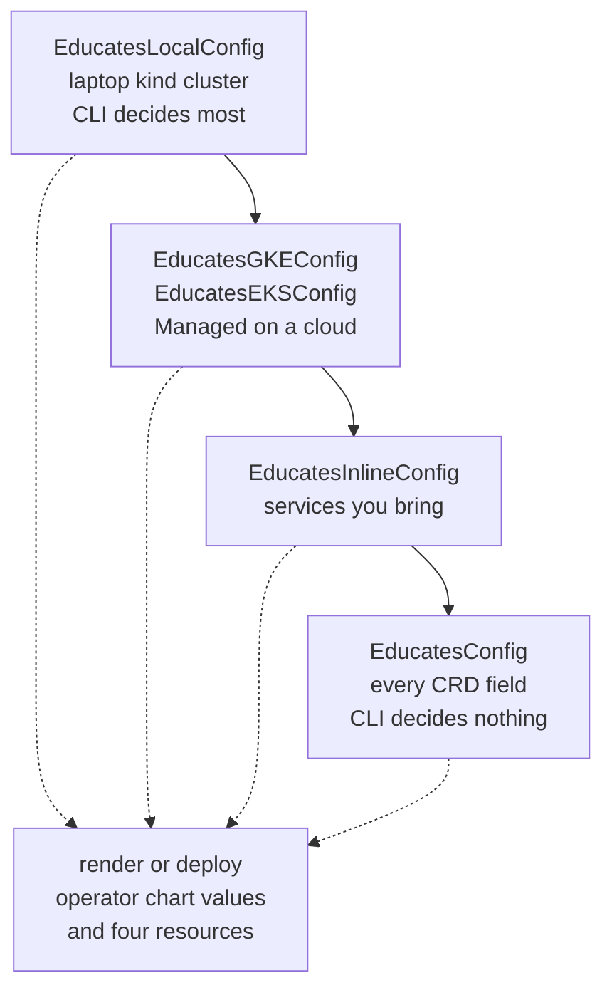

In [Part 1](/blog/installing-educates-4-with-helm), we installed Educates 4 the way a GitOps tool does: the operator's Helm chart plus four resources. In [Part 2](/blog/educates-4-operator-and-crds), we followed the operator as it reconciles those four singleton resources and reports their status. This last part is about the `educates` CLI, which is where most of you start. You describe an install as a config kind, a short versioned YAML file, and the CLI translates it into the chart's values and the four resources. It never applies the config kind to a cluster.

Educates 4.0 isn't final yet at the time of writting this post, so be mindful that some output might have changed. Always look at the current docs.

## One Values File for Every Install

Educates 3 configured every install, laptop or cloud, with one `values.yaml`. It had no `apiVersion` and no `kind`. The CLI decoded it into a single Go struct with 23 top-level keys, and one string, `clusterInfrastructure.provider`, chose which of eight provider folders of ytt overlays, 78 files in all, expanded it into the values of Carvel packages. [How the installer works (Part 1)](/blog/how-installer-works-part-1) walked through that expansion, and it took two extra commands, `educates admin platform config` and `educates admin platform values`, just to show you what it produced.

That shape worked, but it failed late and in the wrong language. The 3.x docs told you to set the kind cluster's pod and service ranges like this, and here the domain is misspelled as well:

```yaml
localKindCluster:
  networking:
    podCIDR: 10.244.0.0/16
    serviceCIDR: 10.96.0.0/12
clusterIngress:
  domian: educates.test
```

Decoded the way the 3.x CLI decodes it, with a strict YAML unmarshal into that struct, the file fails like this:

```
unable to parse default config file values.yaml: yaml: unmarshal errors:
  line 3: field podCIDR not found in type config.KindNetworkingConfig
  line 4: field serviceCIDR not found in type config.KindNetworkingConfig
  line 6: field domian not found in type config.ClusterIngressConfig
```

Two of those three errors are the documentation's: the code only ever knew `podSubnet` and `serviceSubnet`. The rest of the friction was just as plain:

- **One shape for every scenario.** A laptop file accepted `aws`, `gcp` and `clusterPackages`, and a GKE file accepted `localKindCluster`. Nothing said which fields mattered where.
- **Errors in Go types.** `config.KindNetworkingConfig` tells you how the CLI is built, not what to write.
- **A failed edit was lost.** `educates local config edit` validated your changes on exit and, when they failed, threw them away with the temporary file.
- **No editor help.** There was no schema, so no completion, hover or inline validation.
- **The real configuration was hidden** behind the provider overlays.

## Config Kinds, Read Like a kubeconfig

Educates 4 replaces the file with configuration kinds that share an envelope you already read every day:

```yaml
apiVersion: cli.educates.dev/v1alpha1
kind: EducatesLocalConfig
```

It is the same idea as a [kubeconfig](https://kubernetes.io/docs/concepts/configuration/organize-cluster-access-kubeconfig/), which is `apiVersion: v1` and `kind: Config`, or kind's own [cluster configuration](https://kind.sigs.k8s.io/docs/user/configuration/), a `Cluster` at `kind.x-k8s.io/v1alpha4`. `v1alpha1` carries its usual Kubernetes meaning: the shape may still change.

The CLI reads `apiVersion` and `kind` first, rejects any other version, picks that kind's schema, validates the file, and only then decodes it. There are five cluster kinds, and they form a ladder:



- **`EducatesLocalConfig`** is a kind cluster on your laptop. The envelope plus a listen address is a complete install.
- **`EducatesGKEConfig` and `EducatesEKSConfig`** are a GKE or EKS cluster where Educates installs and manages the ingress controller, certificates, DNS and policy engine.
- **`EducatesInlineConfig`** is a cluster that already has an ingress controller, certificates and a policy engine, such as OpenShift.
- **`EducatesConfig`** is the escape hatch: the specs of the four resources, verbatim, with no CLI defaults at all.

Each rung down exposes more choices and decides less for you. Below the bottom rung there is no CLI at all, only `helm install` and `kubectl apply`, which is where [Part 1](/blog/installing-educates-4-with-helm) started.

No rung is ever applied to a cluster, so no cluster ever holds an `EducatesGKEConfig`. `educates admin platform render` translates any rung into the operator chart values and the four resources and prints them, `educates admin platform deploy` translates and installs them, and `educates admin platform export` goes the other way, reading a live cluster back as the bottom rung.

## The Laptop Rung

`educates local config init` writes the smallest config there is:

```
$ educates local config init --listen-address 10.10.10.1
wrote /Users/me/Library/Application Support/educates/config.yaml
$ educates local config view --raw
# yaml-language-server: $schema=https://schemas.educates.dev/cli/v1alpha1/EducatesLocalConfig.json
apiVersion: cli.educates.dev/v1alpha1
kind: EducatesLocalConfig
cluster:
  listenAddress: 10.10.10.1
```

It lives in the data home, `~/Library/Application Support/educates` on macOS and `~/.local/share/educates` on Linux. A first install doesn't even need `init`: `educates local cluster create` writes the same file when there is none, with your host's current IP address as the listen address. That address must be a specific IP of your host, neither `0.0.0.0` nor loopback; [Running Several Educates Clusters on One Laptop](/blog/multiple-local-clusters) explains why, and how each named cluster gets a config of its own.

`view --raw` prints the file as written. `view` without it prints what the CLI will actually use, and says where the extra values came from:

```
$ educates local config view
# yaml-language-server: $schema=https://schemas.educates.dev/cli/v1alpha1/EducatesLocalConfig.json
#
# Effective EducatesLocalConfig with all CLI defaults applied. Values
# absent from the configuration file are filled in by the CLI: static
# defaults, the image registry and version compiled into this CLI, and
# (when no ingress.domain is set) the nip.io name of cluster.listenAddress,
# with ingress.insecure defaulted to true.
#
# To see the configuration file as written, run:
#   educates local config view --raw
# (file: /Users/me/Library/Application Support/educates/config.yaml)
#
apiVersion: cli.educates.dev/v1alpha1
kind: EducatesLocalConfig
cluster:
  listenAddress: 10.10.10.1
ingress:
  domain: 10-10-10-1.nip.io
  insecure: true
clusterAdmin: true
lookupService: true
imagePrePuller:
  enabled: true
operator:
  image:
    repository: ghcr.io/educates/educates-operator
    tag: 4.0.0
  logLevel: info
```

Three layers fill those values in, and we keep them apart on purpose:

- **Static defaults**, applied when the file loads: `clusterAdmin`, `lookupService`, the image pre-puller and the `info` log level.
- **The CLI binary**: the operator image comes from the CLI's own registry and version, so one CLI version always installs the operator of the same version.
- **Local cluster rules**: with no `ingress.domain`, the domain becomes the nip.io name of the listen address, now with dashes where 3.x used dots, and `ingress.insecure` becomes `true`, so a first install needs no certificate authority.

`init --defaults` writes that effective config into the file instead. The catch is that it pins the operator tag, so a newer CLI keeps installing the old operator until you remove the line. The minimal file follows the CLI.

The file never carries certificates. For a domain of your own, `render` and `deploy` take a cached wildcard certificate or mint a CA from a cached root CA, and with neither they stop and print the commands that fix it.

The rest of the kind is short on purpose: the kind cluster itself (API server, subnets, volume mounts and [nodes](/blog/multi-node-local-clusters)), extra resolver domains, the lookup service, the image pre-puller, website styling, image versions and the operator. It has no mode, DNS, ACME, registry prefix or analytics; those live further down the ladder. The registry mirrors every local cluster shares sit beside it in `mirrors.yaml`, a kind of their own, `EducatesLocalMirrors`.

## Five Lines In, Four Resources Out

Render that five-line file, with no cluster and no CA:

```
$ educates admin platform render --local-config
# === operator chart values (helm install -f - educates-installer ...) ===
image:
  repository: ghcr.io/educates/educates-operator
  tag: 4.0.0-alpha.14
logLevel: info
# === platform CRs (kubectl apply -f - ...) ===
apiVersion: config.educates.dev/v1alpha1
kind: EducatesClusterConfig
metadata:
  name: cluster
spec:
  ingress:
    certificates:
      provider: None
    controller:
      bundledContour:
        envoyServiceType: ClusterIP
      provider: BundledContour
    domain: 10-10-10-1.nip.io
    ingressClassName: contour
    protocol: http
  mode: Managed
  policyEnforcement:
    clusterPolicy:
      engine: Kyverno
    kyverno:
      provider: Bundled
    workshopPolicy:
      engine: Kyverno
---
apiVersion: platform.educates.dev/v1alpha1
kind: SecretsManager
metadata:
  name: cluster
spec:
  logLevel: info
---
apiVersion: platform.educates.dev/v1alpha1
kind: LookupService
metadata:
  name: cluster
spec:
  ingress:
    prefix: lookup
  logLevel: info
---
apiVersion: platform.educates.dev/v1alpha1
kind: SessionManager
metadata:
  name: cluster
spec:
  imagePrePuller:
    enabled: true
  logLevel: info
  network:
    blockedCidrs:
      - 169.254.169.254/32
      - fd00:ec2::254/128
  storage:
    storageGroup: 1
```

Five lines became one Helm values file and four custom resources, each a singleton named `cluster`, in the order `deploy` applies them. What each resource does is the subject of [Part 2](/blog/educates-4-operator-and-crds). Everything that isn't in your file is the laptop rung's locked choices: Managed mode, Contour with a `ClusterIP` Envoy service on host ports 80 and 443 (kind has no load balancer), Kyverno for both policy engines, `storageGroup: 1`, and the cloud metadata addresses blocked from sessions.

Render is deterministic for a given config file and CLI version, with its keys sorted, so the output diffs cleanly in a review or in Git. That is why the translator never looks at the environment: the command applies the nip.io name, the CLI version and the certificate decision before translating. `--local-config` is the laptop mode that applies those local rules. `--config` is the explicit mode for a file of any kind, so an `EducatesLocalConfig` passed that way has to set its own domain:

```
$ educates admin platform render --config local-no-domain.yaml
Error: ingress.domain is required when using --config.
Set it explicitly in local-no-domain.yaml, or use --local-config to fall back to the nip.io
name of cluster.listenAddress.
```

## The Cloud Rungs: GKE and EKS

On a cloud, the 3.x file was where the provider string earned its keep. This is a 3.x GKE config in the shape the [cloud install post](/blog/install-educates-cloud-cli) used:

```yaml
clusterInfrastructure:
  provider: "gke"
  gcp:
    project: "my-gcp-project"
    cloudDNS:
      zone: "workshops.example.com"
    workloadIdentity:
      external-dns: "external-dns@my-gcp-project.iam.gserviceaccount.com"
      cert-manager: "cert-manager@my-gcp-project.iam.gserviceaccount.com"
clusterSecurity:
  policyEngine: "kyverno"
clusterIngress:
  domain: "workshops.example.com"
```

The same install as an `EducatesGKEConfig`:

```yaml
apiVersion: cli.educates.dev/v1alpha1
kind: EducatesGKEConfig
gcp:
  project: my-gcp-project
domain: workshops.example.com
acme:
  email: ops@example.com
```

What changed:

- The provider string became the kind.
- The project stays under `gcp`, and the two Workload Identity service accounts default to `cert-manager` and `external-dns` in that project, so you set them only when yours are named differently.
- The Cloud DNS zone is gone: the operator scopes external-dns to the ingress domain.
- Kyverno is locked, so there is no policy engine to choose.
- `acme.email` is new and required. The ACME server defaults to Let's Encrypt production.

Rendered, those seven lines turn into this `EducatesClusterConfig` spec:

```yaml
spec:
  dns:
    bundledExternalDNS:
      cloudDNS:
        project: my-gcp-project
        workloadIdentityServiceAccount: external-dns@my-gcp-project.iam.gserviceaccount.com
      provider: CloudDNS
      sources:
        - service
    provider: BundledExternalDNS
  ingress:
    certificates:
      bundledCertManager:
        acme:
          email: ops@example.com
          solvers:
            dns01:
              cloudDNS:
                project: my-gcp-project
                workloadIdentityServiceAccount: cert-manager@my-gcp-project.iam.gserviceaccount.com
              provider: CloudDNS
        issuerType: ACME
      provider: BundledCertManager
    controller:
      bundledContour:
        envoyServiceType: LoadBalancer
      provider: BundledContour
    domain: workshops.example.com
    ingressClassName: contour
  mode: Managed
  policyEnforcement:
    clusterPolicy:
      engine: Kyverno
    kyverno:
      provider: Bundled
    workshopPolicy:
      engine: Kyverno
```

The CLI decided the rest: external-dns and cert-manager on Cloud DNS through Workload Identity, an ACME DNS01 issuer for the wildcard certificate, and Contour behind a `LoadBalancer`. Leave `acme` out and the schema tells you why it is there:

```
Error: gke-noacme.yaml: schema validation failed:
  - acme: required unless externalTLSTermination is true; it holds the ACME issuer settings for the wildcard certificate
```

`externalTLSTermination: true` is for a cloud load balancer or proxy that terminates TLS in front of the cluster. No certificate is issued inside the cluster, URLs still use `https`, and `acme` is no longer required.

`EducatesEKSConfig` is the same stack on Route53 with IRSA:

```yaml
apiVersion: cli.educates.dev/v1alpha1
kind: EducatesEKSConfig
aws:
  accountId: "123456789012"
  region: us-east-1
  route53HostedZoneId: Z0123456789ABCDEF
domain: academy-01.workshops.example.com
acme:
  email: ops@example.com
```

The IRSA roles default to `educates-cert-manager` and `educates-external-dns` in that account. The [infrastructure providers guide](https://docs.educates.dev/en/latest/installation-guides/infrastructure-providers.html) lists what you create beforehand for either cloud: the DNS zone and the two identities.

## Clusters That Bring Their Own Services

`EducatesInlineConfig` is for a cluster that already runs an ingress controller, certificates and a policy engine. Educates installs nothing at cluster scope; you tell it what is there. On OpenShift:

```yaml
apiVersion: cli.educates.dev/v1alpha1
kind: EducatesInlineConfig
domain: educates.apps.example.com
ingressClassName: openshift-default
wildcardCertificateSecret: wildcard-tls
policyEnforcement:
  clusterEngine: OpenShiftSCC
  workshopEngine: Kyverno
```

It renders to an `EducatesClusterConfig` in Inline mode that records what you declared, and nothing more:

```yaml
spec:
  inline:
    ingress:
      domain: educates.apps.example.com
      ingressClassName: openshift-default
      wildcardCertificateSecretRef:
        name: wildcard-tls
    policyEnforcement:
      clusterPolicyEngine: OpenShiftSCC
      workshopPolicyEngine: Kyverno
  mode: Inline
```

The wildcard certificate Secret has to exist in the operator's namespace before you deploy; a Secret in another namespace takes the escape hatch. `educates local cluster create` refuses this kind: it creates a kind cluster only from an `EducatesLocalConfig`, or from an `EducatesConfig` whose `target` names kind.

## The Escape Hatch

When no narrow kind fits, `EducatesConfig` takes the four resource specs as they are, each under the camelCase name of its kind:

```yaml
# yaml-language-server: $schema=https://schemas.educates.dev/cli/v1alpha1/EducatesConfig.json
apiVersion: cli.educates.dev/v1alpha1
kind: EducatesConfig
educatesClusterConfig:
  mode: Managed
  ingress:
    domain: workshops.example.com
    ingressClassName: contour
    controller:
      provider: BundledContour
    certificates:
      provider: StaticCertificate
      staticCertificate:
        tlsSecretRef:
          name: wildcard-tls
          namespace: educates-secrets
  policyEnforcement:
    clusterPolicy:
      engine: Kyverno
    workshopPolicy:
      engine: Kyverno
    kyverno:
      provider: Bundled
secretsManager: {}
sessionManager:
  imagePrePuller:
    enabled: true
```

Rendered, it produces exactly what it declares: empty operator values, `{}`, and three resources, since it has no `lookupService` block. That is the point of the bottom rung. The translator wraps each block with `apiVersion`, `kind` and `metadata.name: cluster`, and does nothing else. You give up everything the narrow kinds did for you:

- **No defaults.** The image pre-puller stays off unless you turn it on, the CRD's default, where every narrow kind turns it on. The lookup service exists only if you add its block, and then it needs `ingress.prefix`.
- **No invariants.** Nothing derives a domain, picks certificates or blocks the metadata addresses.
- **No Secrets from the local cache.** You create the Secrets the specs reference yourself, such as `wildcard-tls` above.
- **Less validation in the CLI.** The CRDs' own rules are left to the API server.

Its schema isn't written by hand. `make generate-cli-schemas` builds it from the four CRDs the operator chart ships, and CI regenerates it and fails on any difference, so the CLI accepts what the CRDs accept by construction rather than by promise. An optional `target` block carries the only CLI side effects at this rung: with `provider: kind`, `educates local cluster create --config` creates a kind cluster and sets up the local resolver from it.

`export` is the way down from any rung. Whatever a cluster was installed from, it reads the live specs back as an `EducatesConfig`, API server defaults and `kubectl edit` changes included, ready to move to another cluster or to commit:

```bash
educates admin platform export > educates.yaml
educates admin platform deploy --config educates.yaml --diff
```

Deployed back to the same cluster, the export changes nothing, which is what that `--diff` shows. It holds no Secret: a comment names the Secrets the specs reference, which another cluster needs first. Every deploy also records a revision in the cluster, which `educates admin platform history` lists and `educates admin platform drift` compares with the live resources. The [configuration settings guide](https://docs.educates.dev/en/latest/installation-guides/configuration-settings.html#educatesconfig-escape-hatch) documents every block of the escape hatch.

## Validated Before It Reaches a Cluster

Every kind has a JSON schema embedded in the CLI, and every command that reads a config validates against it. The hand-written schemas of the narrow kinds reject unknown fields at every level, describe every field, and encode the rules that span fields, like `acme` unless `externalTLSTermination`. Here are the mistakes from the 3.x file, written against `EducatesLocalConfig`:

```yaml
apiVersion: cli.educates.dev/v1alpha1
kind: EducatesLocalConfig
cluster:
  listenAddress: 10.10.10.1
  networking:
    podCIDR: 10.244.0.0/16
    serviceCIDR: 10.96.0.0/12
ingress:
  domian: educates.test
```

```
$ educates admin platform render --config local.educates.yaml
Error: local.educates.yaml: schema validation failed:
  - ingress: Additional property domian is not allowed
  - cluster.networking: Additional property podCIDR is not allowed
  - cluster.networking: Additional property serviceCIDR is not allowed
```

The errors name the path in your file, not a Go type. A field from another rung, such as an `acme` block in a local config, fails the same way, as `- (root): Additional property acme is not allowed`.

`educates local config set` edits the file in place, keeping its comments, the modeline and the key order, and writes it only if the result still validates:

```
$ educates local config set ingress.domian workshops.educates.test
Error: set "ingress.domian" rejected by schema validation. /Users/me/Library/Application Support/educates/config.yaml would become invalid:
  - ingress: Additional property domian is not allowed
$ educates local config set operator.logLevel verbose
Error: set "operator.logLevel" rejected by schema validation. /Users/me/Library/Application Support/educates/config.yaml would become invalid:
  - operator.logLevel: operator.logLevel must be one of the following: "debug", "info", "warn", "error"
$ educates local config set dns.provider Route53
Error: set "dns.provider" rejected by schema validation. /Users/me/Library/Application Support/educates/config.yaml would become invalid:
  - (root): Additional property dns is not allowed
$ educates local config set imagePrePuller false
Error: set "imagePrePuller" rejected by schema validation. /Users/me/Library/Application Support/educates/config.yaml would become invalid:
  - imagePrePuller: takes an object, not a boolean; set imagePrePuller.enabled instead, writing "imagePrePuller: {enabled: false}" in place of "imagePrePuller: false"
```

Where a generic schema error would only confuse, as with the last one, a table of rules rewrites it into a line that says what to write. `explain` answers from the same schemas, in the style of [`kubectl explain`](https://kubernetes.io/docs/reference/kubectl/generated/kubectl_explain/), for any kind with `--kind`:

```
$ educates local config explain gcp --kind gke
FIELD:    gcp <Object>

DESCRIPTION:
    Google Cloud project and Workload Identity settings. cert-manager and external-dns authenticate to Google Cloud through these service accounts, so no static credentials are stored.

FIELDS:
  certManagerServiceAccount <string>
    Service account email the cert-manager workload impersonates via Workload Identity. Empty defaults to cert-manager@<project>.iam.gserviceaccount.com.
  externalDNSServiceAccount <string>
    Service account email the external-dns workload impersonates via Workload Identity. Empty defaults to external-dns@<project>.iam.gserviceaccount.com.
  project <string> -required-
    Google Cloud project that owns the Cloud DNS zone and the Workload Identity service accounts.
```

`edit` opens a copy of the file in `$EDITOR`. When your changes don't validate, it reopens the copy with the error inline, the way `kubectl edit` does, until the file is valid or you save it empty. With `operator.logLevel: trace` added, the reopened copy reads, below its header:

```
## /Users/me/Library/Application Support/educates/config.yaml.16222: schema validation failed:
##   - operator.logLevel: operator.logLevel must be one of the following: "debug", "info", "warn", "error"
##
# yaml-language-server: $schema=https://schemas.educates.dev/cli/v1alpha1/EducatesLocalConfig.json
apiVersion: cli.educates.dev/v1alpha1
kind: EducatesLocalConfig
operator:
  logLevel: trace
cluster:
  listenAddress: 10.10.10.1
```

Save it empty to give up, and the CLI keeps a copy of your changes beside the config, which stays as it was. In 3.x, the same mistake lost the edit.

Editors get the schemas through the `yaml-language-server` modeline that `init` writes: any editor using the [YAML language server](https://github.com/redhat-developer/yaml-language-server) completes, hovers and validates from it. Not yet, though. `schemas.educates.dev` returns 404 until 4.0.0 ships, because the job that publishes the schemas runs only on final release tags. Until then, a file in your repository can point its modeline at a tag's copy, which resolves today:

```yaml
# yaml-language-server: $schema=https://raw.githubusercontent.com/educates/educates-training-platform/4.0.0-alpha.14/client-programs/pkg/config/v1alpha1/schemas/EducatesGKEConfig.schema.json
```

Name such files `*.educates.yaml`, the convention the [schema notes](https://github.com/educates/educates-training-platform/blob/develop/developer-docs/json-schemas.md) document for a SchemaStore entry once the schemas are published.

## Coming from 3.x

On a laptop, you don't migrate by hand. The first 4.0 command that needs the local config finds a 3.x `values.yaml` whose provider is `kind` or empty, translates it to an `EducatesLocalConfig`, moves any registry mirrors to `mirrors.yaml`, keeps the original as `values.yaml.v3-backup`, and prints a line for each thing it changed or dropped. [Running Several Educates Clusters on One Laptop](/blog/multiple-local-clusters#upgrading-from-a-single-cluster) shows that receipt. Check two things after it. Settings the laptop kind has no place for, such as an analytics tracking ID, are dropped without a line. And an explicit nip.io domain from 3.x becomes a custom domain in 4.0, secure by default, so set `ingress.insecure` or remove the domain to get the dashed nip.io default.

Any other provider gets an honest error and an untouched file: the DNS, ACME and identity wiring of a cloud install can't be guessed safely, so the CLI lists the five kinds and asks you to declare one. The [migration guide](https://docs.educates.dev/en/latest/installation-guides/migrating-from-v3.html) maps each 3.x provider to its kind and each removed command to its replacement. `educates create-cluster` and `educates deploy-platform --config` still work as aliases, but there is no in-place upgrade of a 3.x cluster install: delete it and install 4.0.

## Design Rationale

- **Why a ladder.** A single config shape has to either expose everything and stop being opinionated, or hide things and leave power users stuck. Narrow kinds keep the common scenarios short, validated and defaulted, and the escape hatch means there is no ceiling. To keep the ladder from sprawling into untested shapes, we add a scenario kind only once a tested sample resource for it exists in [`installer/samples`](https://github.com/educates/educates-training-platform/tree/develop/installer/samples); samples `01` to `04` back the four narrow kinds today.
- **Why the escape hatch is verbatim.** Passing the specs through makes translation mechanical, with no field mapping to maintain and no way for the escape hatch to fall behind the CRDs. Defaults and invariants are what you stepped down the ladder to get away from, and adding them back would rebuild the ceiling.
- **Why migration is silent and laptop-only.** The laptop file is the only one the CLI owns. A cloud config lives in your repository with intent the CLI can't infer, and a lossy translation would produce plausible but wrong resources, which is worse than an error.
- **Why providers are frozen.** How each cluster service is provided is fixed for the life of an install. Switching in place would need a transition for every pair of providers and can break a running cluster, while an Educates cluster is cheap to recreate.

---

Start at the highest rung that fits your cluster, and step down only when you need a field it doesn't expose: the laptop kind on a laptop, the GKE or EKS kind for a Managed cloud install, Inline when the cluster brings its own services, and `EducatesConfig` for everything else. Render before you deploy, keep the file in Git, and export when you need to know what a cluster really holds. That is the recommended way to configure Educates 4, because whichever rung you start from, you end up with the same chart values and four resources the operator reconciles.
