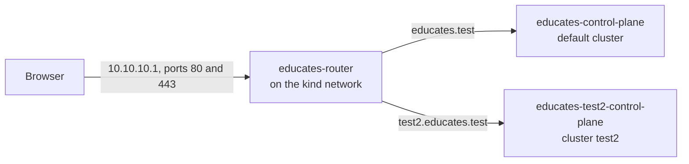

Until now, the Educates CLI assumed there was exactly one local cluster on your machine. A second `educates local cluster create` failed with "cluster for Educates already exists", and there was no way around it.

We are pleased to announce that, in Educates 4.0, you can run named local clusters beside the default one. A command you run without a cluster name behaves as it always did, and a second cluster is one command away.

4.0 isn't final yet, so everything here uses the latest prerelease at the moment of writing, 4.0.0-alpha.15. Use that version or a later one: a 3.x CLI knows only one cluster, and can delete what the others need, and earlier 4.0 prereleases served each cluster on a host address of its own, which recent Docker Desktop releases no longer allow.

## The Problem with One Local Cluster

The 3.x CLI hardcoded everything about its local cluster: the kind cluster `educates`, its node and its kube context. Pointing `EDUCATES_CLI_DATA_HOME` at a second folder didn't help either. The second cluster still wanted to be called `educates`, bind the same ports 80 and 443, and manage the same registry and resolver containers.

That is a hassle as soon as one cluster isn't enough, and when you work on Educates or on workshops for it, that happens often:

- **Comparing builds.** A branch build beside the release you are comparing it with.
- **Testing upgrades.** A fresh install beside an upgraded one.
- **Spanning clusters.** A Lookup Service that spans two clusters.
- **Working in parallel.** Several agents working on the platform at once, each on a cluster of its own.

The only way out was to tear down one cluster to create the next, or to build a kind cluster by hand and lose the registry, mirror and resolver wiring the CLI does for you.

## Named Local Clusters

In 4.0, the cluster you have always created is the default local cluster, and you can create any number of named ones beside it:

```bash
educates local cluster create --local-cluster test2
```

That writes the cluster's config to the data home, creates the kind cluster `educates-test2` with the kube context `kind-educates-test2`, and installs Educates in it, while the default cluster keeps running. Everything about a named cluster derives from its name, so you never have to remember which context goes with which cluster. That includes its domain: with none given, `test2` is served at its name under the nip.io name of the router address, such as `test2.10-10-10-1.nip.io`. Add `--domain` for a domain of your own.

### One router for every cluster

Educates builds every workshop URL on ports 80 and 443 with no port suffix, so clusters can't be told apart by port. They are told apart by name. Every local cluster is served through one router, `educates-router`, an HAProxy container on Docker's `kind` network. It publishes ports 80 and 443 once, on the router address, and sends each request to the control-plane node of the cluster that owns the name it asks for: plain HTTP by the `Host` header, and HTTPS by the server name in the TLS handshake. Kind nodes publish no ports on your host at all.



HTTPS passes through the router untouched, so each cluster still presents its own certificate, and the router holds no cluster's keys. When several domains match a name, the most specific one wins, so `workshop.test2.educates.test` reaches `test2` and `workshop.educates.test` the default cluster. Over plain HTTP, a name no cluster serves gets a plain-text 404 listing the domains the router serves, and a stopped cluster's name gets a 503 naming the cluster and the `educates local cluster start` command that brings it back. Over HTTPS the router has no certificate to answer those with, so it closes the connection instead.

Earlier 4.0 prereleases did this differently. Each cluster had a host IP of its own, `cluster.listenAddress`, and published its ports 80 and 443 there. Docker Desktop 4.100.0 broke that. macOS lets a process that isn't root bind a port below 1024 only on the wildcard address, and Docker Desktop now binds such a publish there whatever address it names, so a second cluster's publish of port 80 failed with the port already in use. One publish of each port is what Docker Desktop serves, so now the clusters share it.

### The router address

The router address is the one host address the local environment needs. It lives in `router.yaml` in the data home, a kind of its own, `EducatesLocalRouter`, since every cluster shares it:

```yaml
# yaml-language-server: $schema=https://schemas.educates.dev/cli/v1alpha1/EducatesLocalRouter.json
apiVersion: cli.educates.dev/v1alpha1
kind: EducatesLocalRouter
# This host's IP address when this file was written. An alias such as
# 10.10.10.1, added to a network interface, survives network changes.
address: 192.168.1.10
```

The first `educates local cluster create` writes it with your host's IP address. The address has to be a specific IP that one of your host's network interfaces has. `0.0.0.0` names no address the clusters' names could resolve to. A loopback address such as `127.0.0.1` works from your browser, but not from inside a cluster, where a pod resolving the ingress domain would reach itself instead of your host.

Your host's IP changes when your laptop moves between networks, and the router never follows it, since a nip.io domain contains the address. An alias on a network interface survives network changes. The CLI never runs `sudo`, so adding one is a one-time step that is yours to take. On macOS, the [fixed IP post](/blog/fixed-ip-bridge-macos) gives your machine a `bridge1` interface at `10.10.10.1`. Then make it the router address:

```bash
educates local router update --address 10.10.10.1
```

That checks that the address is really on one of your interfaces, writes it to `router.yaml`, points the DNS resolver at it, and re-creates the router there, while the clusters keep running. A cluster on the nip.io name of the old address takes the new name, and the command names each such cluster with the `educates admin platform deploy --local-config` command that deploys it again. One alias serves every cluster, where earlier prereleases needed one for each.

If you use Docker Desktop 4.97 or later, there is one more setting: turn on **Settings > Advanced > Allow privileged port forwarding to external machines**. Without it, Docker Desktop serves ports below 1024 on loopback only, and the router, and with it every local cluster, is unreachable from your browser. `educates local cluster create` and `educates local cluster start` refuse to run while the setting is off.

`educates local router status` shows the router and where it sends each name:

```
Router address:   10.10.10.1
Router:           running (educates-router), publishing ports 80 and 443 on 10.10.10.1
Image:            haproxy:3.4.8-alpine@sha256:8aa6458a9d22a8364a2d2ee9ce93de0cc4a2789e3cf63f0b44adc972863724d7

NAME                      CLUSTER     TLS           STATE
educates.test             (default)   passthrough   running
test2.10-10-10-1.nip.io   test2       passthrough   stopped
```

### Picking the cluster you mean

You select a cluster per command with `--local-cluster`, or per terminal with the `EDUCATES_LOCAL_CLUSTER` environment variable. It works like `kubectl --context` and `KUBECONFIG`, minus a stored current context: the CLI never remembers a selection, so one terminal can work on `test2` while another works on the default cluster, and neither follows the other. With a cluster selected, the `educates cluster` and `educates admin` commands use its kube context, whatever context kind last made current.

`educates local cluster list` shows the router address, then every local cluster, running or stopped:

```
Router address: 10.10.10.1

NAME        STATE     NODES   KUBERNETES   DOMAIN                    CONTEXT
(default)   running   1       v1.36.4      educates.test             kind-educates
test2       stopped   3       v1.36.4      test2.10-10-10-1.nip.io   kind-educates-test2
```

`educates cluster workshop serve` follows the selection too. It listens on the router address, on a free port it picks for each run, so two terminals can serve one workshop to two clusters at once, and an edit shows in the sessions of both.

### What every cluster shares

Each cluster has its own name, domain, config and kube context, but some things are the same for all of them, so there is only one of each:

- **One router.** It publishes ports 80 and 443 on the router address, and sends each name to the cluster that owns it.
- **One registry.** `localhost:5001` serves every cluster, so a workshop you publish once can be deployed to all of them.
- **One set of registry mirrors.** Mirrors are declared once for the whole machine, and linked into every node of every cluster.
- **One DNS resolver.** It resolves every cluster's names to the router address, and like the router, it picks the most specific domain. A cluster on `test2.educates.test` gets its own name, while every other name under `educates.test` still reaches the default cluster.
- **One root CA.** You trust it once, and every cluster's domain gets an intermediate CA minted from it, so a named cluster can serve HTTPS with nothing new to trust.

A named cluster with no domain uses its name under the nip.io name of the router address, over plain HTTP, so it needs no CA and no resolver entry at all.

Clusters no longer clash on addresses, only on domains, since a name leads to one cluster. `educates local cluster create` and `start` refuse a domain that another cluster, running or stopped, already claims, before kind runs. A subdomain of another cluster's domain is no clash.

Deleting a named cluster keeps its config, so creating it again brings it back as it was. And `delete --all` removes the shared router, registry, mirrors and resolver only with the last local cluster, never while another one still needs them, and keeps `router.yaml`.

### Letting the router end TLS

The router can also play the cloud load balancer that ends TLS in front of a cluster, the setup `externalTLSTermination` declares for GKE, EKS and Inline installs. Set it in a local cluster's config before you create the cluster:

```yaml
ingress:
  domain: test2.educates.test
  externalTLSTermination: true
```

The router then ends TLS for the cluster's domain with a certificate from your local CA, and sends each request on as plain HTTP with `X-Forwarded-Proto: https`. The cluster installs no cert-manager, its URLs still use HTTPS, and its ingress trusts the forwarded headers the router sets, so you can check how a workshop behaves behind a load balancer without leaving your laptop. `educates local router status` shows its domain as `terminated` in the `TLS` column.

### Upgrading from a single cluster

Your first 4.0 command migrates your 3.x config and tells you what it changed, including where the address went. A 3.x cluster that left its listen address to kind, which published its ports on every host address, gets your host's IP address as the router address:

```
migrated /Users/me/Library/Application Support/educates/values.yaml → /Users/me/Library/Application Support/educates/config.yaml; original saved as /Users/me/Library/Application Support/educates/values.yaml.v3-backup
wrote /Users/me/Library/Application Support/educates/router.yaml with this host's IP address 192.168.1.10 as the router address: localKindCluster.listenAddress was not set, so the cluster published its ports 80 and 443 on every host address, and every local cluster is now served on the router address, a specific IP address of the host. An alias such as 10.10.10.1, added to a network interface, survives network changes, where the host's IP address may not
```

Three changes need you to act:

- **A cluster from an earlier CLI has to be created again.** Kind fixes the ports a node publishes when it creates the cluster, so a cluster created by 3.x or by an earlier 4.0 prerelease publishes ports 80 and 443 from its own node, which leaves the router nothing to bind. Creating the router fails, naming each such cluster with the commands that delete it and create it again.
- **A prerelease config loses `cluster.listenAddress`.** The first command that reads a config in the data home moves the default cluster's address to `router.yaml`, drops a named cluster's, and keeps the previous config as a backup beside it. A config outside the data home fails, saying where the address went, and the `--listen-address` option is gone.
- **The resolver sync LaunchAgent has nothing left to do.** Every cluster's names resolve to the router address, which doesn't follow your host's IP, so the agent from the [resolver sync post](/blog/sync-resolver-macos) is no longer needed. Unload it, and make an alias the router address instead.

## Conclusions

One local cluster was enough until it wasn't, and the workarounds cost you the very wiring that makes local clusters handy. Give the router one stable address, name the clusters beside the default, and select the one you mean per terminal. That is the recommended way to run more than one Educates cluster on your laptop, because every cluster gets the same router, registry, mirrors, resolver and CA without any of them stepping on the others.

The [router address](https://docs.educates.dev/en/latest/getting-started/local-environment.html#router-address) and [running several local clusters](https://docs.educates.dev/en/latest/getting-started/local-environment.html#running-several-local-clusters) sections of the local environment docs cover adding an alias on macOS and Linux, the router's commands, selecting clusters, serving one workshop to several clusters, and cleaning up. The [migration guide](https://docs.educates.dev/en/latest/installation-guides/migrating-from-v3.html) covers the rest of the move from 3.x.

In the next post, we'll give a local cluster more than one node, with the labels and taints of a production node pool: [Multi-Node Local Clusters](/blog/multi-node-local-clusters).
